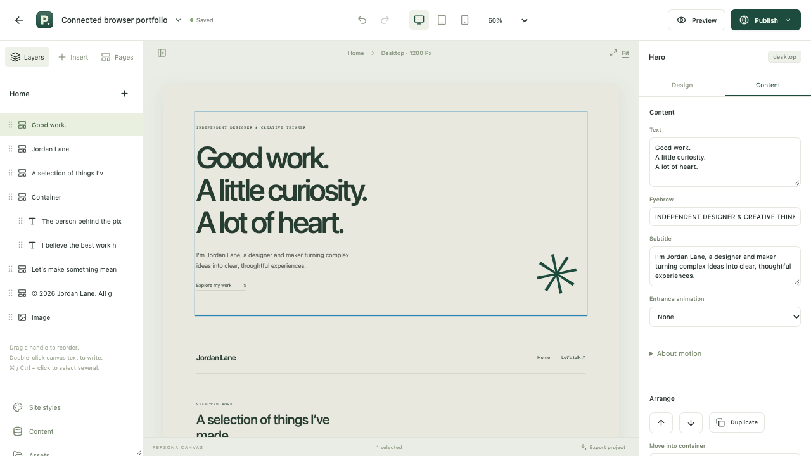

# Persona

Your work. Your identity. Your web.

Persona combines the existing Expo application with an independent, local-first portfolio studio. The existing Expo source and both Git histories are preserved; the working studio is integrated additively under `studio/` on `testing`.



## Portfolio studio — web / PWA

With Node 24 or later:

```sh
cd studio
npm ci
npm run dev
```

Open `http://localhost:3100/` for the integrated product landing. Choose Open App to enter the studio; later visits open it directly. Click the Persona logo to return to the landing without losing your editor state. Local editing works without an account. Publishing requires the separate delivery listener and a configured server.

- [Studio overview](studio/README.md)
- [Architecture and documentation](studio/docs/INDEX.md)
- [Ideas collection](studio/docs/IDEAS.json)
- [X-Center hosting plan](studio/docs/XCENTER.md)
- [Integration decisions and validation](studio/docs/reports/UADS-36.md)

## Existing Expo application

The original Expo SDK 57 starter remains at the repository root. Its source, dependencies and configuration have not been rewritten. It is not yet a native version of the portfolio editor. [Original starter instructions](docs/EXPO_STARTER.md).

## Licensing and distribution

Original portfolio studio code is **AGPL-3.0-only**; see [studio/LICENSE](studio/LICENSE). The Expo starter retains its original MIT notice in [LICENSE](LICENSE). No existing license was replaced.

This repository retains its existing public visibility. Development uses `testing`; `master` and its history are preserved. No hosted deployment, public binary release or additional distribution channel is activated by this integration.
