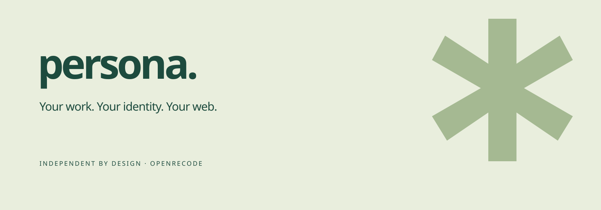

A self-hostable portfolio studio with a visual editor, six templates, reusable content, private drafts, immutable publishing and independent static exports. No subscriptions, advertising, forced branding or required AI service.

**This is a working 0.1 implementation, with explicit limitations.** See the [feature matrix](docs/FEATURES.md), [validation report](docs/reports/VALIDATION.md) and [remaining work](docs/ROADMAP.md). Do not treat prepared Docker/domain configuration as external production validation.

## Run locally

Requires Node.js 24+ and npm. No SDK, database service, Redis or paid provider is needed for local SQLite development.

```sh
npm ci
cp .env.example .env
npm run migrate
npm run dev
```

Open [Persona](http://localhost:3100). Published websites use the separate [public delivery listener](http://localhost:3101). Continue without an account to work locally; create an account to use the self-hosted API and publishing. Sample template content is fictional and must be replaced before real publication.

```sh
npm run check
npm test
npm run build
npm run test:e2e
```

Browser tests use an installed Chrome locally and bundled Chromium in CI. No browser is downloaded by the test command itself. If needed in your own environment: `npx playwright install chromium`, then `CI=true npm run test:e2e`.

## Production and export

```sh
# Set separate APP_ORIGIN and PUBLIC_ORIGIN in .env, use HTTPS in production.
npm run build
npm start
# Optional separate worker: set EXTERNAL_WORKER=true for the app first.
npm run worker
# Operator CLI; points at the configured database and storage.
npm run export -- WEBSITE_ID portfolio.zip
# Configure APP_HOST, SITES_HOST, POSTGRES_PASSWORD and ACME_EMAIL first.
docker compose up -d --build
```

The default server embeds one publishing worker. Docker Compose runs a dedicated worker and PostgreSQL, plus persistent filesystem assets and Caddy. **Run only one worker per instance.** See [deployment](docs/DEPLOYMENT.md), [domains](docs/DOMAINS.md), [API](docs/API.md) and [documentation index](docs/INDEX.md).

The interface exports two different ZIPs: an editable Persona project and a static website. Static output includes HTML pages, styles, linked assets, PWA icons, an offline worker and routing directories. It does not require a Persona backend for rendering. Its contact section uses a configured email or clearly states that delivery is unconfigured; instance inboxes are not silently linked.

## Product tour

- Dashboard: create, search, sort, filter, duplicate, rename, archive, restore, import and export sites.
- Studio: sandboxed visual canvas, direct text editing, layers, nested components, pointer/keyboard reordering, copy/paste, undo/redo, responsive inspector, themes and revision restoration.
- Library: structured collections with shared bindings, generated detail pages and validated image/PDF uploads.
- Publishing: queued builds, immutable snapshots, deployment logs, rollback, unpublishing, separate public origin and privacy-friendly opt-in request counts.
- Website tools: DNS TXT challenges, CNAME checks, Caddy certificate authorization, SEO controls and contact inbox.
- Settings: sessions, passkeys, SMTP-enabled verification/recovery, privacy, account export/deletion, release checks and changelog. Tap the version three times for expiring Developer Options and offline Ideas.

## Contribute and license

Original code and branding are **AGPL-3.0-only**. See [LICENSE](LICENSE), [third-party notices](docs/THIRD_PARTY.md), [contributing](CONTRIBUTING.md) and [security policy](SECURITY.md). Network operators must provide the Corresponding Source for the version they offer, as required by AGPL section 13. Third-party assets retain their own licenses.

Development repository: [Xarber/persona-studio](https://github.com/Xarber/persona-studio). The repository is private during development. No public deployment or store release has been authorized. Web/PWA is the supported platform; native iOS/Android binaries are not part of this project.
